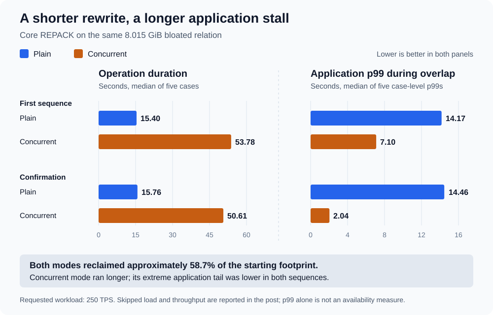

## Trying Out REPACK in PostgreSQL 19

One of the most highly touted features in PostgreSQL 19 was [REPACK](https://www.postgresql.org/docs/19/sql-repack.html).  A built-in way to reclaim space from bloated tables, with an option to keep reads and writes running during most of the operation?  That's a welcome alternative to scheduling a `VACUUM FULL`!

I wanted to verify for myself how well it worked, so I tried it out.  How much space would it reclaim?  How long would it take?  And what would happen to an application workload running alongside it?

The results were encouraging.  Plain and concurrent REPACK reclaimed essentially the same amount of space from my test table.  Plain REPACK finished much faster, while concurrent REPACK reduced the long blocking stall experienced by the application.  We'll get into the details a bit more, but first:

## What Does Repacking a Table Do?

For those not already familiar with MVCC, Postgres updates and deletes don't immediately remove the old row versions from a table.  Once those versions are no longer needed, regular `VACUUM` makes their space available for reuse.  It generally doesn't shrink the relation files, except when it can truncate empty pages at the end.  That reuse is normally exactly what we want, but after a large delete or a period of heavy updates, we may want to return unused space to the operating system (and bloat has the habit of slowing down even the fastest of systems when it comes to table scans).

`VACUUM FULL` does this by rewriting the table and rebuilding its indexes.  The catch is that it holds an `ACCESS EXCLUSIVE` lock throughout the operation, blocking reads and writes to the table.

REPACK also rewrites the table and rebuilds its indexes, but offers a concurrent mode that allows ordinary reads and writes during most of that work.  It still needs an exclusive lock to finish the operation; we'll look at that below.

The commands are straightforward:

```sql
REPACK public.accounts;
REPACK (CONCURRENTLY) public.accounts;
```

Repacking isn't a new idea.  The external `pg_repack` extension has provided an online table-reorganization option for years.  PostgreSQL 19 brings that maintenance option into core through its own implementation, without requiring the extension.  These tests used the core command.

## Setting Up

Each case started with a fresh, deterministic `accounts` table, a primary key, and a secondary index.  I created bloat through repeated updates to indexed keys and payloads, followed by deletes.  The resulting total relation size, including indexes, was **8.015 GiB** before each operation.

One `pgbench` process ran continuously before, during, and after REPACK.  It had eight clients and four threads, with a requested rate of 250 transactions per second.  Each transaction updated a surviving row and then read its version back.

The workload needed to select rows that still existed.  After deleting rows to create bloat, choosing random IDs from the original range can produce updates that affect nothing.  Those transactions can look wonderfully fast without doing the work we intended to measure.  I used a dense map of live IDs to avoid that.

The workload also had a one-second latency limit.  Scheduled transactions that fell too far behind could be skipped, and I retained those skips as evidence of overload.  They weren't silently discarded or treated as successful work.  Actual transaction failures, deadlocks, or serialization errors invalidated a case.

For this experiment, I also disabled client lock and statement timeouts so that I could measure how long requests waited for the lock.  Application timeouts should follow the application's availability requirements.

I ran two complete test sequences, each with five repetitions per mode.

## Same Compaction, Different Duration

Here are the medians for the physical result and command duration:

| Sequence | Mode | Space reclaimed | Duration |
|----------|------|----------------:|---------:|
| First | Plain | 58.714% | 15.40 s |
| First | Concurrent | 58.712% | 53.78 s |
| Confirmation | Plain | 58.713% | 15.76 s |
| Confirmation | Concurrent | 58.705% | 50.61 s |

The first sequence finished near **3.31 GiB**, reclaiming about **4.7 GiB** per case.  The physical difference between modes was tiny: 0.002 percentage points in the first sequence and 0.008 in the confirmation.

So there wasn't a meaningful compaction-density advantage to choosing one mode over the other for this table.  Plain REPACK completed in roughly one-third the time, though.

> You may wonder why 58.7% keeps showing up in each row -- I would like to point out that the loading and bloating of the table was consistently reproducible in a way that allowed the `REPACK` calls to reclaim the same amount of space.

Looking at the table, it would be easy to stop there and say plain REPACK was the winner.  But command duration isn't the same thing as application impact.

## What Happened to the Application?

Looking only at transactions overlapping the exact REPACK interval, the first sequence showed:

| Metric, median across five cases | Plain | Concurrent |
|---------------------------------|------:|-----------:|
| Successful overlap TPS | 34.34 | 17.30 |
| p50 latency | 49.4 ms | 521.6 ms |
| p95 latency | 936.9 ms | 2,200.5 ms |
| p99 latency | 14,170.5 ms | 7,098.4 ms |
| Skipped transactions during overlap | 3,235 | 12,782 |

Plain REPACK's p99 was about **14.2 seconds** against a command that took about 15.4 seconds.  This indicates that the application request is waiting through much of the operation.  This is somewhat unsurprising, as REPACK without `CONCURRENTLY` holds an `ACCESS EXCLUSIVE` lock like `VACUUM FULL` does.

Concurrent REPACK reduced that extreme tail, but its median and p95 latencies were worse in this sequence, and it skipped more scheduled work.  It ran for longer, so it also spent longer competing with the application.

The confirmation is important here.  Plain REPACK again produced a severe p99 stall, about **14.5 seconds**.  Concurrent REPACK's p99 was lower, about **2.0 seconds**, while successful overlap TPS was 36.21 versus 35.58 for plain.

In other words, concurrent throughput and latency varied materially between sequences.  The repeatable observation was **a long blocking tail for plain REPACK**, versus **a longer, still-disruptive operation without the same sustained freeze for concurrent REPACK**.



The chart shows medians across five cases per mode in each sequence.  The right panel summarizes the per-case p99 latencies during operation overlap.  Its time scale differs from the duration panel.  Both modes reclaimed about 58.7%; the application experienced different waiting patterns.  Neither sustained the requested 250 TPS during overlap, and skipped-load counts cover different-length operation windows.

## CONCURRENTLY Doesn't Mean No Locks

Plain REPACK holds an `ACCESS EXCLUSIVE` lock throughout the rewrite, blocking reads and writes to the table.  Concurrent REPACK does most of its work under a less restrictive lock, capturing ongoing changes through logical decoding and applying them to the replacement data.

I sampled target-relation locks using one persistent observer connection at roughly 40 ms intervals.  Across the first sequence, it recorded 1,777 `AccessExclusiveLock` samples for plain REPACK and 160 for concurrent REPACK.

Concurrent REPACK still needs an `ACCESS EXCLUSIVE` lock for the final relation/index file swap.  That means an existing conflicting lock can delay the swap, and queries arriving behind the exclusive-lock request can also end up waiting.

For an operational run, it's possible to bound that wait rather than assume that the word `CONCURRENTLY` protects the application:

```sql
SET lock_timeout = '3s';
REPACK (CONCURRENTLY) public.accounts;
RESET lock_timeout;
```

Be sure to choose a timeout that fits your application's availability target, and understand that a timeout can abort the operation after substantial work.

There are other eligibility and correctness considerations too.  [The current documentation](https://www.postgresql.org/docs/19/sql-repack.html#SQL-REPACK-NOTES-ON-CONCURRENTLY) lists restrictions involving replica identity, relation type, and transaction blocks, and warns that concurrent REPACK is **not MVCC-safe** for transactions using snapshots taken before repacking began.  Review those restrictions before scheduling the operation.

There was useful visibility in [`pg_stat_progress_repack`](https://richyen.com/pg-catalog-almanac/#/r/pg_stat_progress_repack), too:

```sql
SELECT pid,
       command,
       phase,
       heap_blks_total,
       heap_blks_scanned,
       index_rebuild_count
FROM pg_stat_progress_repack;
```

Every accepted case produced progress rows.  Plain cases showed heap scanning followed by index rebuilding.  Concurrent cases also exposed initialization and catch-up.  During catch-up, writes made while the new relation is being built are replayed in preparation for the final swap.

## REPACK Needs Headroom, Regardless of Table Size

It is important to remember that during a rewrite, the old relation and its replacement coexist, with indexes and WAL/change-capture requirements on top.  For this lab, the harness required at least four times the target relation size in free storage and twice the target size in WAL headroom before setup.

In the first sequence, the median observed platform WAL-storage delta was **1.39 GiB for plain** and **3.47 GiB for concurrent**.  The largest sampled concurrent increase was **8.36 GiB**.

Concurrent cases also exposed a temporary logical replication slot lifecycle.  Every accepted run ended with the slot inventory matching its starting state and zero logical slots; the existing physical HA slot was unchanged.

## Final Thoughts

`REPACK CONCURRENTLY` is a useful addition for cases where we would otherwise consider `VACUUM FULL`, especially when we can't take the table out of service for the entire rewrite.  In this lab, allowing concurrent writes didn't meaningfully change the compaction result, though it did extend the operation.  Neither mode replaces healthy routine vacuuming, and a larger table or a different write workload deserves its own test.  Nevertheless, kudos to the Postgres community for rolling this feature in!
