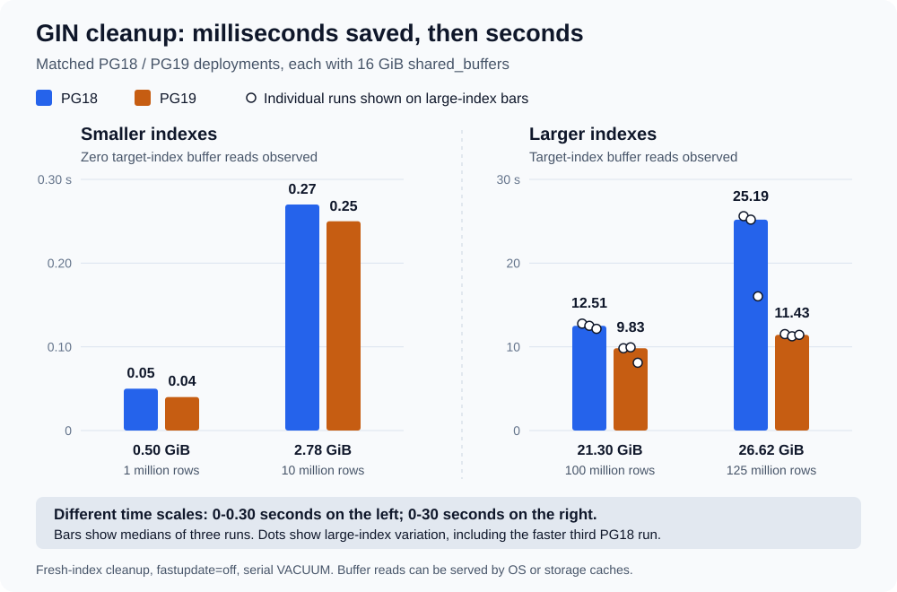

## Trying Out GIN VACUUM in PostgreSQL 19

PostgreSQL 19 improves how VACUUM reads GIN indexes during cleanup, allowing that path to use streaming reads.  I was curious how much of a difference that would make in practice, so I tried it out.

If an index is already in PostgreSQL's buffer cache, there may not be much time to save by changing how pages are read.  But what happens when the index is larger than the cache?

I compared PostgreSQL 18.6 and PostgreSQL 19 with GIN indexes ranging from 0.50 GiB to 26.62 GiB.  The servers had 16 GiB of `shared_buffers`, giving me a chance to test both situations.

The small indexes finished cleanup in fractions of a second.  The larger indexes were where the comparison became interesting: **1.27x median speedup at 21.30 GiB, and 2.20x at 26.62 GiB**.

The size of the benefit will depend on the workload and environment.

## Why GIN Can Have So Much to Read

GIN indexes are useful when one row contains many searchable items: words in a document, elements in an array, or keys and values in a `jsonb` value.

Unlike a simple index entry for a single scalar key, one row can contribute many GIN entries.  An application can have a fairly ordinary-looking row count and still accumulate a substantial GIN index.

During cleanup, VACUUM may need to walk a large part of that index.  The amount of heap cleanup and the amount of index-reading work aren't necessarily proportional.

PostgreSQL 19's streaming-read change makes that walk an interesting upgrade candidate.  The expected benefit is easier to observe when PostgreSQL has to read index pages into its buffers, rather than finding everything there already.

That gave the experiment a specific question: **does the PG18-to-PG19 difference change when the GIN index outgrows `shared_buffers`?**

## Keep the Comparison About Index Cleanup

I used three independent PG18/PG19 pairs on matched Azure Database for PostgreSQL Flexible Server deployments.  Each database had a dedicated runner, and the six cases at each size ran concurrently on their separate deployments.

The servers used 16 vCPUs, General Purpose compute, 1 TiB Premium storage, zone-redundant HA, and private networking.  Each had `shared_buffers = 16 GiB`.

Every case started with a fresh database, regular logged table, and logged GIN index.  At each size, I ran three independently prepared cases per version.

Using a generic table name, the schema was:

```sql
CREATE TABLE public.docs (
    id bigint NOT NULL,
    tags text[] NOT NULL,
    document tsvector NOT NULL,
    payload text NOT NULL
) WITH (
    autovacuum_enabled = false,
    toast.autovacuum_enabled = false
);

CREATE INDEX docs_search_gin
ON public.docs
USING gin (tags, document)
WITH (fastupdate = off);
```

Autovacuum was disabled only for these isolated benchmark tables so it couldn't compete with the measured operation.  Keep it enabled for normal application tables.

The deterministic data supplied eight array elements, a seven-token `tsvector`, and a fixed-size payload per row.  I froze the heap after loading it and before creating the GIN index.  With `fastupdate=off`, the test also avoided mixing pending-list behavior into the comparison.

This setup isolated **cleanup of a freshly built GIN index**.  Measuring a complete maintenance cycle on a heavily updated application table would require additional tests, including dead-tuple removal under concurrent writes.

Full-table fingerprints before index creation, immediately before VACUUM, and afterward retained the same row count, ID sum, ID bounds, and content hash in every case.

## Measuring VACUUM

The measured command was:

```sql
VACUUM (
    VERBOSE,
    INDEX_CLEANUP ON,
    PARALLEL 0,
    PROCESS_TOAST FALSE,
    TRUNCATE OFF
) public.docs;
```

This excluded TOAST processing, parallel vacuum workers, and heap truncation from the intended comparison.

The measured sessions used matching settings:

```sql
SET maintenance_work_mem = '1GB';
SET maintenance_io_concurrency = 32;
SET effective_io_concurrency = 32;
SET vacuum_buffer_usage_limit = '2GB';
SET max_parallel_maintenance_workers = 0;
SET vacuum_cost_delay = 0;
SET vacuum_cost_limit = 10000;
```

These settings kept the experiment consistent across versions.  Production settings need to account for competing work; in particular, turning off cost delay removes a mechanism that can limit maintenance's impact on other work.

The reported time came from the server's `VACUUM (VERBOSE)` output.  Loading the data, building the index, and collecting fingerprints weren't included.

A huge table can take substantial time to prepare even if its measured VACUUM lasts seconds.  Keeping setup out of the measured interval lets us compare the cleanup read path rather than the time spent loading data and building indexes.

## Four Sizes, Two Different Regimes

Here are the medians from three runs per version:

| Rows | GIN size | PG18 time | PG19 time | Speedup | Time reduction |
|-----:|---------:|----------:|----------:|--------:|---------------:|
| 1 million | 0.50 GiB | 0.05 s | 0.04 s | 1.25x | 20.0% |
| 10 million | 2.78 GiB | 0.27 s | 0.25 s | 1.08x | 7.4% |
| 100 million | 21.30 GiB | 12.51 s | 9.83 s | 1.27x | 21.4% |
| 125 million | 26.62 GiB | 25.19 s | 11.43 s | 2.20x | 54.6% |



The panels use different time scales to keep the small-index differences visible.  Bars show the median of three independently prepared runs per version; dots show the individual large-index timings.  The wider spread in PG18's largest case is visible alongside its median.

The small cases show why percentages alone can be misleading.  A 20% reduction from 0.05 to 0.04 seconds is only **10 milliseconds**, at the reporting precision of these measurements.  Cutting a 25-second cleanup to about 11 seconds saves enough time to be more useful operationally.

The two in-cache index sizes recorded zero target-index buffer reads during cleanup.  They fit comfortably inside the 16 GiB allocation, and the operation completed very quickly.

At 100 million rows, the heap was 40.08 GiB and the GIN index was 21.30 GiB.  The measured cleanup read roughly **953,000 target-index blocks** into PostgreSQL's buffers per case.

At 125 million rows, the heap was 50.11 GiB and the GIN index was 26.62 GiB.  Each cleanup recorded roughly **1.657 million target-index block reads**.

One important caveat: a PostgreSQL buffer read means the page wasn't already in PostgreSQL's shared buffers.  It doesn't prove that the page came from physical media; an operating-system or managed-storage cache may satisfy it.  I wouldn't label this a controlled cold-disk benchmark.

Still, the large cases clearly exercised a different buffer-read regime from the small ones.

## Look at the Repeats, Too

The larger-index server times were:

| Rows | Version | Repeat 1 | Repeat 2 | Repeat 3 |
|-----:|---------|---------:|---------:|---------:|
| 100 million | PG18 | 12.77 s | 12.51 s | 12.15 s |
| 100 million | PG19 | 9.83 s | 9.94 s | 8.10 s |
| 125 million | PG18 | 25.61 s | 25.19 s | 16.03 s |
| 125 million | PG19 | 11.52 s | 11.26 s | 11.43 s |

PG19 was faster in every large-index paired comparison.  At 100 million rows, the pairwise speedups ranged from **1.26x to 1.50x**.  At 125 million, they ranged from **1.40x to 2.24x**.

That last range is worth keeping alongside the 2.20x headline median.  PG18's third large run was materially faster than its other two, while PG19's times were close together.  A single summary number doesn't capture all the variation.

Three repeats per version provide an initial view of the variation in this environment.  The comparison also includes all the changes between the two major versions.  Isolating the streaming-read improvement would require matched builds with only that change applied.

## Cache Usage Beyond Index Size

The most useful pattern was cache-sensitive: little operational difference for the small, cached indexes, followed by a consistent advantage for PG19 in the larger cases.

The cache available to an index depends on the rest of the workload.  Other relations also use `shared_buffers`, so even a smaller index may require reads if the application has displaced its pages.

The opposite can happen too.  An index larger than `shared_buffers` may benefit from other cache layers.  Recent scans, index construction, fingerprints, and competing work all affect cache history.

The settings also affect the comparison.  Read concurrency, vacuum buffer usage, cost delay, storage configuration, and concurrent activity can change what the maintenance operation experiences.

Based on these results, **the new GIN cleanup read path is most worth evaluating when your current cleanup spends meaningful time reading index pages into PostgreSQL's buffers.**

## What I Would Check Before an Upgrade

Start with the indexes themselves:

```sql
SHOW shared_buffers;

SELECT n.nspname AS schema_name,
       c.relname AS index_name,
       pg_size_pretty(pg_relation_size(c.oid)) AS index_size
FROM pg_class AS c
JOIN pg_namespace AS n ON n.oid = c.relnamespace
JOIN pg_am AS am ON am.oid = c.relam
WHERE c.relkind = 'i'
  AND am.amname = 'gin'
ORDER BY pg_relation_size(c.oid) DESC;
```

Then look at representative VACUUM evidence.  Record elapsed time, index reads and hits, maintenance settings, cache history, and concurrent storage activity.  If collecting cumulative statistics, take before/after snapshots rather than attributing a server's lifetime counters to one operation.

For a version comparison, keep the data, index definition, settings, and maintenance task comparable.  Don't measure a newly built index on one version against an already-vacuumed index on the other.

And if production cleanup is driven by deletes, updates, pending-list work, or application contention, test those conditions too.  This cleanup-only lab doesn't tell us how much the full autovacuum cycle or application latency will improve.

## Final Thoughts

On these matched deployments, PostgreSQL 19 reduced median GIN cleanup time by **21.4% at 21.30 GiB** and **54.6% at 26.62 GiB**.  The small indexes completed too quickly for their differences to carry much operational weight.

The size and cache behavior of the index influenced the benefit considerably.  The largest case showed a 2.20x median speedup, while the small, cached indexes saved only milliseconds.

If GIN cleanup already occupies a noticeable part of your maintenance window, this is a PostgreSQL 19 change worth testing with your own data.  Record index size, buffer reads, and cleanup time to see how much of that window the new read path could save.
